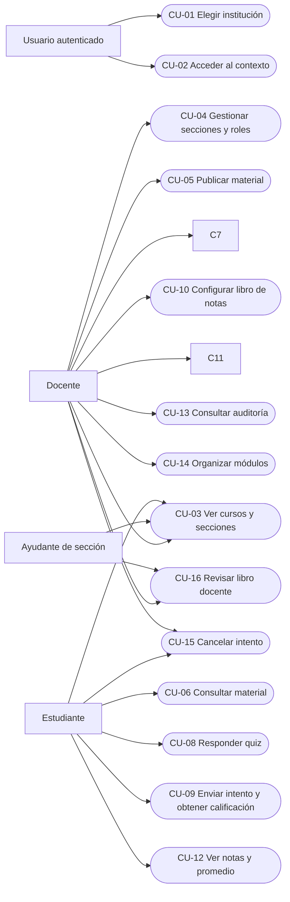

## Casos de uso del MVP

| Caso | Meta principal |
| --- | --- |
| [CU-01](03-requirements-part-04.md#cu-01--elegir-institución) | Elegir una institución accesible. |
| [CU-02](03-requirements-part-05.md#cu-02--acceder-al-contexto-institucional) | Entrar al contexto institucional autorizado. |
| [CU-03](03-requirements-part-06.md#cu-03--ver-cursos-y-secciones) | Encontrar cursos y secciones propios. |
| [CU-04](03-requirements-part-07.md#cu-04--gestionar-secciones-y-roles) | Mantener secciones y participantes del curso. |
| [CU-05](03-requirements-part-08.md#cu-05--publicar-material) | Poner material a disposición del curso. |
| [CU-06](03-requirements-part-09.md#cu-06--consultar-material) | Acceder a material publicado. |
| [CU-07](03-requirements-part-10.md#cu-07--crear-y-publicar-quiz) | Preparar y ofrecer un quiz válido. |
| [CU-08](03-requirements-part-11.md#cu-08--responder-quiz) | Guardar respuestas en un intento propio. |
| [CU-09](03-requirements-part-12.md#cu-09--enviar-intento-y-obtener-calificación-automática) | Finalizar un intento y registrar su calificación. |
| [CU-10](03-requirements-part-13.md#cu-10--configurar-libro-de-notas) | Definir ponderaciones del curso. |
| [CU-11](03-requirements-part-14.md#cu-11--publicar-notas) | Hacer visibles notas calificadas. |
| [CU-12](03-requirements-part-15.md#cu-12--ver-notas-y-promedio) | Consultar notas propias publicadas. |
| [CU-13](03-requirements-part-16.md#cu-13--consultar-auditoría) | Revisar historial académico del curso. |
| [CU-14](03-requirements-part-17.md#cu-14--organizar-módulos-del-curso) | Ordenar y publicar módulos. |
| [CU-15](03-requirements-part-18.md#cu-15--cancelar-un-intento-en-progreso) | Cerrar un intento abandonado sin calificarlo. |
| [CU-16](03-requirements-part-19.md#cu-16--revisar-el-libro-de-notas-docente) | Consultar resultados del curso dentro del alcance autorizado. |

### Vista funcional de actores y casos

El siguiente diagrama usa nodos ovalados para los casos de uso y flechas para
la relación actor–meta. Mermaid no proporciona una figura nativa de caso de uso
UML; la aproximación conserva únicamente actores, casos y sus asociaciones.

### Reglas comunes de lectura

En todos los casos académicos, el usuario está autenticado y mantiene una
pertenencia activa a la institución elegida, salvo que un flujo alternativo
indique la pérdida de esa condición. Un recurso inexistente o ajeno a la
institución no se revela; una acción prohibida sobre un recurso visible se
rechaza. Estas reglas se aplican de nuevo en cada operación, sin asumir que una
validación anterior sigue vigente. Los flujos detallan las variaciones propias
de cada meta.
