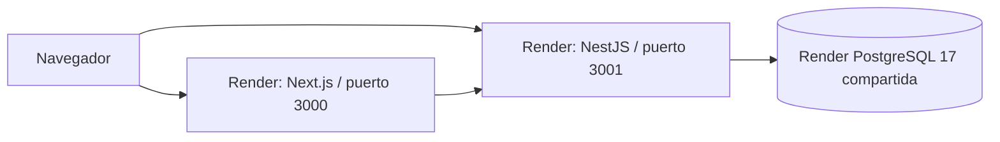

# Arquitectura actual de AcademiX

Revisión documental 2026-10-29, E2 C6. Configuración existente en el corte
7f4334a; este polish no despliega ni acredita estado remoto.
Fuente: [render.yaml](../../../render.yaml) y [ADR Render](../../adr/deploy-on-render.md).

## Topología configurada

Dos servicios Docker y una base. UC/UTFSM son tenants lógicos dentro de esa
base, no réplicas ni bases separadas. No hay HAProxy, PgBouncer externo,
réplicas de aplicación o PostgreSQL HA en el Blueprint actual.
Pool pg del proceso reutiliza conexiones; no equivale a pooling externo.
Render gestiona el ingreso HTTPS; no se agrega un balanceador propio.

## Contexto y seguridad

Identidad global JWT; ruta `/api/v1/institution/{institutionSlug}/...` solicita
contexto y membership activa lo autoriza. Host/Origin no conceden tenant.
Enrollment aporta teacher/student/assistant por sección. Flags institucionales
is_admin e is_super_admin son independientes; propiedad no equivale a docencia.
FK compuestas y RLS protegen datos tenant-owned; runtime academix_runtime no
es dueño ni tiene bypass. Secretos de migración se retiran antes del HTTP.

Creación de cursos y onboarding ya estaban implementados. Ver
[actores](05-domain-model.md), [cuentas](../../guides/demo-accounts.md) y
[ADR de permisos](../../adr/institution-admin-and-course-ownership.md).
AuditEvent conserva historia append-only sanitizada. Grade exige docencia al
leer auditoría; owner sin teacher conserva administrativos según
[ADR de privacidad](../../adr/grade-audit-visibility.md).

## Operación declarada y límites

Blueprint: branch main, autoDeployTrigger checksPass, healthcheck `/ready` para
API y `/` para frontend. Comando API `node dist/commands/serve.js`: predeploy
idempotente en proceso hijo, luego arranque HTTP. Frontend usa API pública
`https://academix-backend-lr8x.onrender.com`; UC/UTFSM tienen dominios frontend.
No confundir el destino histórico api.dvillasc.me con la URL configurada.

Plan free según la configuración y ADR: suspensión por inactividad, cuota
compartida y base con expiración; no se promete disponibilidad continua, backup
ni PITR del plan actual. El operador debe verificar vigencia y respaldo antes
de una entrega remota. No se consultó proveedor ni DNS durante este polish.
Docker Compose y CI son mecanismos locales/versionados; presencia en Git no
prueba ejecución remota. Validación nueva: [evidencia](../../backend/feedback-e2-validation.md).

## Evolución diferida

HAProxy, PgBouncer externo, HA, réplicas y failover necesitan métricas y una
misión que justifique costo/operación; se retiran del dibujo actual. Sharding,
restore por institución y nuevos servicios tampoco son capacidades entregadas.
Binarios/object storage están fuera del MVP markdown; proveedor sin decidir.
La propuesta anterior queda recuperable en Git sin fingirla desplegada.
