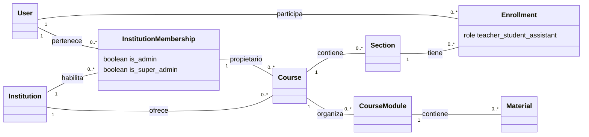
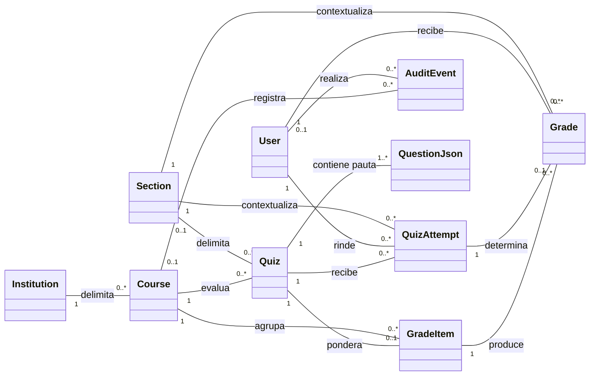

# Modelo de dominio en UML

La pauta de Entrega 2 pide representar los conceptos fundamentales mediante un
diagrama de clases. Las clases siguientes son conceptos del problema, no clases
definitivas de implementación. El modelo se divide para mantener legibilidad.

## Identidad, institución y contenido

`User` es global. `InstitutionMembership` habilita el acceso base a una
Institution, mientras Enrollment concentra los roles académicos contextuales:
`teacher`, `assistant` y `student`. Todas las clases académicas son
tenant-owned por una Institution aunque el diagrama omita relaciones repetidas
para evitar ruido visual.

## Evaluaciones, notas y trazabilidad

Quiz, QuizAttempt, GradeItem, Grade y AuditEvent conservan `institution_id`. Las
FK compuestas comprueban que las relaciones del diagrama pertenecen a la misma
Institution. Las preguntas y alternativas son conceptos anidados dentro del JSON
de Quiz, no tablas independientes en el MVP.

Auditoría opcional refleja eventos institucionales y operaciones sin actor HTTP.
QuestionJson es pauta conceptual validada al publicar; borradores incompletos
son posibles. No hay tabla de preguntas. Reglas físicas y conceptuales:
[relaciones contrastadas](06-data-model-relations.md).
