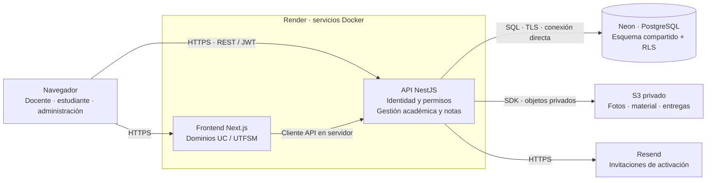

# Arquitectura final de AcademiX

Corte de implementación: **16/11/2026**, commit `7d4b666`. Verificación remota adicional **21/11**: [operación y límites](cierre/operacion-demo.md).
Sustituye la referencia arquitectónica de E2 para E4. [Modelo de datos](modelo-datos.md).

## Diagrama para la presentación

El backend es una aplicación modular única. La institución delimita datos y permisos dentro de la misma base; los dominios frontend no crean bases separadas ni conceden acceso.

## Componentes y responsabilidades

| Componente | Responsabilidad y fuente |
| --- | --- |
| Frontend | Next.js, navegación por institución y cliente generado desde OpenAPI. El navegador llama directamente a la API; el cliente también admite ejecución en servidor. [Cliente](../../../frontend/src/lib/api/client.ts). |
| API | Controladores → servicios → SQL parametrizado con `pg`. Áreas: identidad/altas, cursos/matrículas, material, quizzes/intentos, tareas/entregas, notas/auditoría y calendario. [Registro](../../../backend/src/app.module.ts). |
| PostgreSQL | Transacciones, claves compuestas, RLS e historial. Pool local del proceso, máximo 5 conexiones; endpoint Neon directo, sin `-pooler`. [Acceso](../../../backend/src/database/database.service.ts), [TLS](../../../backend/src/database/config.ts). |
| S3 | Binarios privados; PostgreSQL guarda claves y metadatos. El backend autoriza y transmite lecturas/subidas; el navegador no recibe credenciales del bucket. [Archivos](../../adr/s3-for-academic-files.md). |
| Resend | Envía invitaciones de activación desde backend; estado de envío y aceptación por Resend, reenvío e idempotencia persistidos. La aceptación no confirma entrega al destinatario. [Decisión](../../adr/resend-for-account-invitations.md). |

El calendario consulta plazos de quizzes y tareas: no agrega servicio ni tabla de eventos. [Implementación](../../../backend/src/calendar/calendar.service.ts).

## Aislamiento y permisos

1. `AuthGuard` valida JWT, usuario activo y versión de credencial vigente.
2. La ruta selecciona `institutionSlug`; `withInstitution` verifica institución y pertenencia activas y fija contexto dentro de la transacción.
3. Los servicios aplican rol, propiedad, sección y publicación; RLS y FK compuestas mantienen la frontera institucional.
4. `academix_runtime` no es dueño ni tiene `BYPASSRLS`. Altas e identidad usan funciones SQL específicas con privilegios acotados.

Administración institucional y docencia son permisos independientes. Cada persona tiene como máximo un rol académico activo por sección. Estudiantes consultan notas propias publicadas; corregir/publicar requiere autorización docente sobre la sección.
Identidad, perfil y su auditoría son globales por usuario; no se les asigna un tenant ficticio. [Reglas del modelo](modelo-datos.md#reglas-de-integridad-y-permisos).

## Despliegue y operación

- [Blueprint](../../../render.yaml): frontend y backend desde `main`, disparador `checksPass`; chequeos `/` y `/ready`.
- Arranque API: `serve` ejecuta migraciones/predeploy en proceso hijo; `start` retira secretos operativos antes de cargar HTTP. [Arranque](../../../backend/src/commands/serve.ts), [separación de credenciales](../../../backend/src/commands/start.ts).
- La [release](../../../.github/workflows/release.yml) y el [CI](../../../.github/workflows/ci.yml) definen automatización; el ensayo Neon utiliza una rama temporal para probar migraciones. Su resultado requiere evidencia de ejecución.
- Sin configuración externa, fotos/correo/archivos pueden quedar indisponibles sin impedir el resto de la aplicación. No existe transacción distribuida DB/S3: se compensan fallos y se limpian objetos huérfanos.

## Cambios desde E2 y verificaciones pendientes

| Aspecto | Estado al corte |
| --- | --- |
| Base | Blueprint ya no crea PostgreSQL en Render; configura Neon. El ADR conserva «migración pendiente» y la guía declara Neon: el equipo confirmó el uso efectivo de Neon. |
| Archivos y correo | S3 y Resend tienen implementación/configuración. Resend cuenta con aceptación manual reportada; el 21/11 se acreditó carga/publicación/descarga de TXT por el backend productivo en UC/UTFSM. No se inspeccionó el proveedor físico ni se probó persistencia tras redeploy. |
| Dominio | Se incorporaron perfiles/altas, archivos, tareas/entregas, grupos/revisiones de notas y calendario. |
| Límites | Dos servicios web; sin colas, caché distribuida, réplicas o HA configuradas. El throttling reside en memoria por instancia. |

Fuentes operativas: [Neon](../../adr/neon-database.md), [guía Render](../../guides/render-deploy.md), [aceptación Resend](../../planning/perfiles/evidencia.md), [S3](../../planning/academic-files/s3.md).
El 21/11 health confirmó v0.13.1/7d4b666 y ready respondió 200; pasó el ciclo académico remoto en UC/UTFSM. El [respaldo local](cierre/respaldo-local.md) y el [ensayo remoto](cierre/ensayo-remoto.md) registran los recorridos por navegador. El equipo confirmó Neon; los [despliegues registrados](cierre/evidencia/deploys-render.json) sitúan frontend y backend en 7d4b666. El diagrama representa configuración, no disponibilidad continua.
