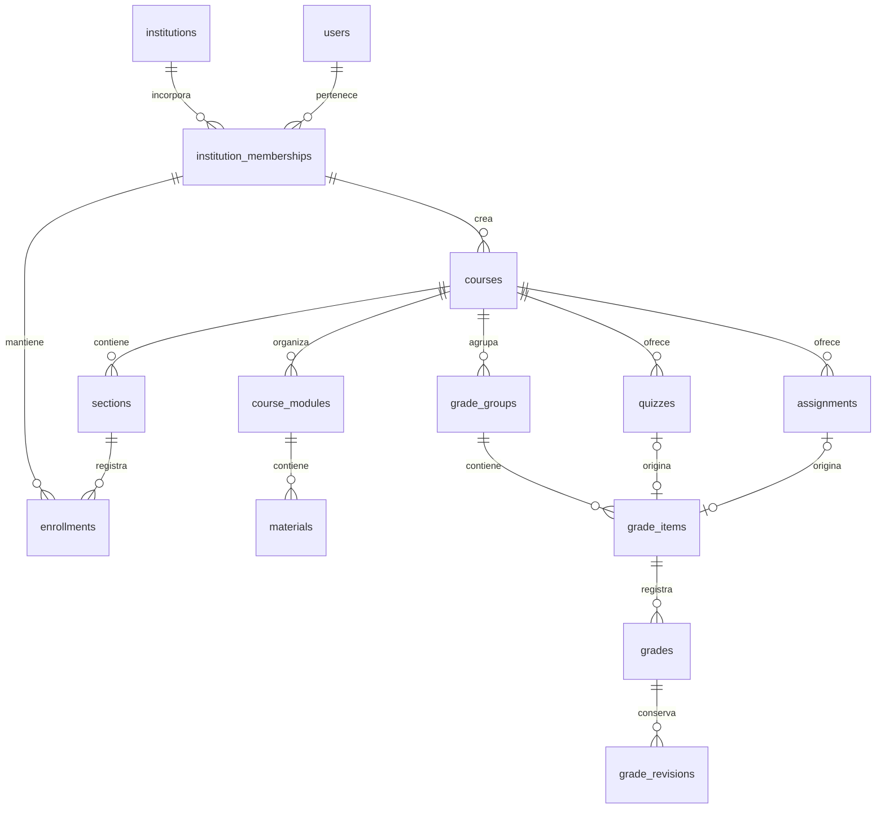

# Modelo de datos final de AcademiX

Corte: **16/11/2026**, commit `7d4b666`. Fuente: **23 migraciones, 24 tablas de aplicación**; excluye la tabla interna del migrador.
Esquema implementado en [migraciones](../../../backend/migrations/); su aplicación remota requiere verificación. [Arquitectura](arquitectura.md).

## Diagrama para la presentación

Síntesis de relaciones principales; intentos, altas e historial complementario se detallan abajo. Nombres físicos de tablas; `o{` significa cero o muchos, `o|` cero o uno.

Cada `grade_item` referencia **exactamente un quiz o una tarea**, nunca ambos. La cardinalidad SQL permite cero o un ítem por origen; el flujo de aplicación crea el ítem al publicar un quiz o crear una tarea.
`courses.created_by` identifica al usuario mediante la pertenencia institucional; no almacena el ID de la pertenencia.

## Inventario y relaciones complementarias

Todas las tablas usan `id` UUID como PK, salvo `demo_data_runs`, cuya PK es `version`.
Las FK institucionales incluyen `institution_id`; los nombres abreviados de la tabla no sustituyen esas claves compuestas.

| Tablas | Relación y datos principales |
| --- | --- |
| `institutions`, `users` | Institución y usuario global. Correo normalizado único; perfil, hash de contraseña, `credential_version` y `avatar_key` en usuario. |
| `institution_memberships` | Une usuario e institución; UNIQUE por par, estado y flags `is_admin`/`is_super_admin`. |
| `courses`, `sections`, `enrollments` | Curso 1:N secciones; pertenencia y sección 1:N matrículas históricas. Curso único por institución/código/período; sección por curso/código. |
| `course_modules`, `materials` | Curso 1:N módulos 1:N materiales ordenados. Material discriminado: `markdown`, `file` o enlace `quiz`; CHECK impide mezclar sus campos. Un quiz puede aparecer en varios módulos, una vez por módulo. |
| `quizzes`, `quiz_attempts` | Quiz de curso, sección opcional; preguntas/opciones en JSONB. Quiz 1:N intentos; cada intento fija estudiante/sección, número, respuestas JSONB, estado y resultado. |
| `assignments`, `assignment_attempts`, `assignment_attempt_files` | Tarea de curso, sección opcional, plazos y reglas de entrega. Tarea 1:N intentos; cada intento conserva texto y/o hasta 5 archivos de hasta 10 MiB. Metadatos y claves privadas, no binarios. |
| `grade_groups`, `grade_items` | Curso 1:N grupos 1:N ítems. Grupo: orden/peso; ítem: título, máximo y origen exclusivo. Tarea guarda su título y puntaje máximo en el ítem. |
| `grades` | Ítem 1:N notas; estudiante 1:N notas; UNIQUE por institución/ítem/estudiante. Cada nota referencia exactamente un intento de quiz o tarea, con FK que conserva estudiante y sección. |
| `grade_revisions` | Nota 1:N revisiones; anterior opcional, autor, motivo, puntaje y fecha. Cadena sin bifurcaciones; corrección de tarea puede seleccionar otro intento del mismo estudiante/tarea/sección. |
| `grade_publications` | Curso 1:N recibos; actor, solicitud JSONB, fecha y cantidad. UNIQUE por institución/actor/clave idempotente; no existe tabla puente publicación-nota. |
| `audit_events` | Eventos institucionales con actor, recurso y cambios JSONB; curso/sección opcionales según acción. `resource_id` es referencia polimórfica, no FK genérica. |
| `account_security_events` | Usuario 1:N eventos globales de perfil/credenciales/foto; actor igual al titular. |
| `account_invitations` | Institución 1:N invitaciones; creador referencia **ID de pertenencia**. Token hasheado, caducidad, estado de envío y usuario aceptante opcional. |
| `user_imports`, `user_import_rows` | Pertenencia creadora 1:N lotes; lote 1:N filas (hasta 100). Cada fila puede referenciar una invitación de la misma institución; CSV original no se persiste. |
| `demo_data_runs` | Registro operativo global de provisión demo: versión, huella de entrada, operador y resultado. |

El calendario es una consulta sobre quizzes/tareas; el libro de notas y los promedios también se calculan. No existen tablas `calendar`, `gradebook`, `questions` ni `roles`.

## Reglas de integridad y permisos

1. **Tenant:** 20 tablas institucionales usan `FORCE RLS`; el contexto se fija por transacción. `users`, `institutions`, `account_security_events` y `demo_data_runs` tienen alcance global/directorio/operativo, no una pertenencia ficticia.
2. **Rol:** CHECK limita matrícula a `teacher`, `student` o `assistant`. Índice único parcial permite como máximo una activa por institución/sección/usuario; las anteriores se archivan.
3. **Permisos:** flags administrativos no conceden docencia. Servicios verifican actor, curso, sección y publicación; RLS no sustituye estas verificaciones. El dueño del curso es inmutable.
4. **Intentos:** número único por institución/evaluación/estudiante; claves de idempotencia evitan duplicar inicio/envío. Quiz conserva respuestas y estados; entrega de tarea conserva evidencia inmutable.
5. **Notas:** borradores no visibles al estudiante; publicación explícita y recibo transaccional. La nota publicada original no se sobrescribe ni elimina: correcciones agregan `grade_revisions` con autor/motivo.
6. **Ponderación:** publicación exige pesos de grupos que sumen 100. `gradebook_grouped` distingue fórmula histórica de cálculo por puntos; `gradebook_version` controla concurrencia. Cambiar grupos tras publicar exige confirmar recálculo y auditarlo.
7. **Puntajes:** quiz requiere máximo positivo; tarea admite cero y queda fuera del promedio. Porcentaje/nota de tarea pueden ser nulos con máximo cero. El máximo de una tarea queda congelado cuando ya existen notas.
8. **Auditoría:** eventos académicos, revisiones y recibos conservan historial. `account_security_events` separa cambios globales; purga de datos personales de altas conserva recibos y referencias académicas.

## Trazabilidad de cambios desde E2

| Cambio | Fuente de implementación o decisión |
| --- | --- |
| Perfil y auditoría global | [Migración de perfiles](../../../backend/migrations/20261107000100_account_profiles.sql). |
| Invitaciones e importaciones | [Invitaciones](../../../backend/migrations/20261107000200_account_invitations.sql), [lotes/filas](../../../backend/migrations/20261107000300_user_imports.sql). |
| Archivos y enlaces a quizzes | [Migración de materiales](../../../backend/migrations/20261109000100_academic_files.sql). |
| Grupos y revisiones | [Migración](../../../backend/migrations/20261109000200_gradebook_groups.sql), [reglas de cálculo e historial](../../adr/gradebook-groups-and-revisions.md). |
| Tareas, entregas y notas | [Tareas](../../../backend/migrations/20261109000300_course_assignments.sql), [entregas](../../../backend/migrations/20261110000100_assignment_submissions.sql), [notas](../../../backend/migrations/20261110000200_assignment_grades.sql). |
| Un rol activo por sección | [Índice y prevalidación](../../../backend/migrations/20261112000100_one_active_section_role.sql), [ADR](../../adr/one-active-role-per-section.md). |
| Frontera institucional | [Validación de RLS al iniciar](../../../backend/src/database/runtime-check.ts), [contexto transaccional](../../../backend/src/database/database.service.ts). |

La presentación usa el diagrama; inventario y reglas sirven de anexo. El DDL completo permanece en las migraciones para evitar un catálogo duplicado que diverja del código.
