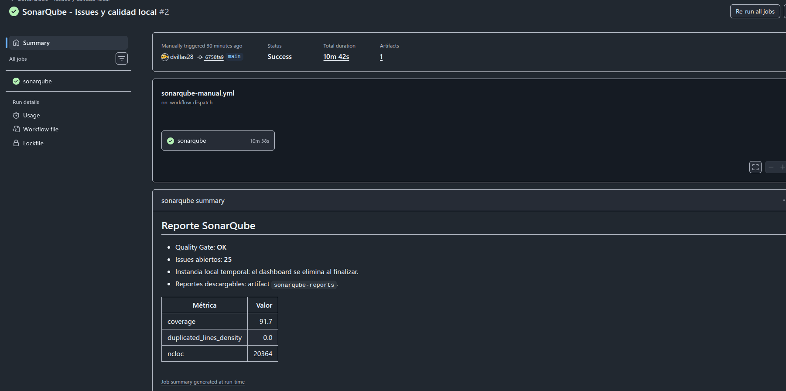

# Entrega 4 — Auditoría manual con SonarQube

Ejecución manual de SonarQube, corrección de todos los issues y reporte posterior.
Fecha: **2026-11-15**. SonarQube Community **26.10.0.133078** (instancia temporal,
sin secretos), mismo `sonar-project.properties` que el CI.

| Corte | Dónde | Commit | Quality Gate | Issues | Cobertura | ncloc |
| --- | --- | --- | --- | --- | --- | --- |
| Antes | GitHub Actions, run [#2](https://github.com/dvillas28/lock-in-team-iic3143-202602/actions/runs/43738811618) | `6758fa9` (`main`) | OK | 25 | 91.7 % | 20 364 |
| Antes | Local | `1218c72` (`dev`) | OK | 25 | 91.7 % | 20 364 |
| Después | Local | `76bc4b9` (`fix/sonarqube-entrega-4`) | OK | **0** | 91.7 % | 20 389 |

`6758fa9` y `1218c72` tienen el mismo árbol (`git diff` vacío): el run de
Actions y el análisis local reportan los mismos 25 issues en las mismas líneas.
Eso valida que la réplica local es equivalente al workflow.

## Por qué el "después" es local

[`sonarqube-manual.yml`](../../../../.github/workflows/sonarqube-manual.yml) solo
corre sobre la rama predeterminada (`main`), así que no puede ejecutarse sobre
esta rama. [`script/sonar-local.sh`](script/sonar-local.sh) replica sus pasos con
la misma imagen y el mismo proyecto:

1. SonarQube en Docker y PostgreSQL 17 efímero.
2. Cobertura de backend (unitarios + integración) y de frontend, igual que el workflow.
3. Proyecto y token temporales, análisis con SonarScanner CLI 8.1 y export de
   `issues.json`, `metrics.json`, `quality-gate.json`, `analysis-task.json` y `run.json`.

Única diferencia: los datos de SonarQube van en `tmpfs`, porque con el disco del
equipo sobre 90 % Elasticsearch no crea índices. No cambia el análisis.

Tras el merge a `main`, el run manual del workflow debería mostrar 0 issues.

## Issues y corrección

Los 25 eran *code smells* (22 MAJOR, 3 MINOR), todos en `frontend/src`.

| Regla | Cant. | Qué marcaba | Corrección |
| --- | --- | --- | --- |
| S6845 | 13 | `tabIndex` en elementos no interactivos | Componente `ScrollRegion` (ver abajo) |
| S6843 | 3 | `role="cell"` en `<td>` de la tabla de participantes | `NOSONAR` justificado (ver abajo) |
| S8786 | 2 | Regex con backtracking (`/\/+$/`, `/\s+$/`) | Recorrido lineal y `trimEnd()` |
| S7737 | 2 | Objeto literal como valor por defecto | Constantes de módulo (`allEvents`, `staffView`) |
| S6852 | 1 | `role="menu"` no enfocable (cancelar intento) | `tabIndex={-1}` en el menú |
| S6848 | 1 | `onKeyDown` en un `<div>` sin rol (añadir contenido) | Teclado en el botón y en el `role="menu"` |
| S9379 | 1 | `autoFocus` en la dirección del enlace | Foco explícito al abrir la fila de enlace |
| S6825 | 1 | `aria-hidden` en el `<canvas>` del PDF | Se quita: un canvas vacío no expone nada |
| S7773 | 1 | `NaN` global | `Number.NaN` |

### Dos excepciones justificadas

No todo se resolvió borrando código, porque en dos casos la regla choca con la
accesibilidad del producto:

- **S6845, 13 casos.** Eran tablas, bloques de código y la página del PDF con
  scroll propio. Necesitan `tabIndex={0}` para poder desplazarse con teclado
  (WCAG 2.1.1, regla axe `scrollable-region-focusable`), y E2E-A11Y-005 lo
  verifica. Quitar el atributo rompería la accesibilidad. Se creó
  [`ScrollRegion`](../../../../frontend/src/components/scroll-region.tsx), que
  reemplaza los 13 usos y concentra la excepción en una sola línea con `NOSONAR`.
- **S6843, 3 casos.** En móvil, la tabla de participantes usa `display: block/grid`,
  y eso hace que algunos navegadores pierdan la semántica de tabla. Los roles
  explícitos la conservan; Sonar interpreta `<td>` como interactivo. Las tres
  líneas llevan `NOSONAR` y un comentario sobre la tabla explica por qué.

En total quedan 4 supresiones explícitas, cada una con su motivo en el código.

## Verificación

| Prueba | Resultado |
| --- | --- |
| `pnpm typecheck` y `pnpm lint` (frontend) | OK |
| `pnpm test` (frontend) | 589/589 |
| Cobertura backend + frontend (dentro del análisis) | Sin fallos; cobertura 91.7 % |
| E2E `regression` en Chromium (`pnpm --dir e2e run test:regression`) | 265/266 |
| SonarQube local sobre `76bc4b9` | Gate OK, 0 issues |

La única falla E2E es E2E-TENANT-007 (historial entre orígenes), que no toca
pantallas modificadas. Con `--repeat-each=3` pasa 1/3 en esta rama y 0/3 en
`dev` (`1218c72`) sin estos cambios: es inestable desde antes.

## Archivos

| Carpeta | Contenido |
| --- | --- |
| [`actions/run-2-main/`](actions/run-2-main/) | Artifact `sonarqube-reports` del run #2 y su [captura](actions/run-2-main/resumen.png). |
| [`antes/`](antes/) | Análisis local sobre `1218c72`. |
| [`despues/`](despues/) | Análisis local sobre `76bc4b9`. |
| [`script/`](script/) | Réplica local del workflow (`sonar-local.sh`, `sonar-api.py`). |



## Cómo reproducir

Desde la raíz, con Docker y las dependencias instaladas (`pnpm --dir backend install`,
`pnpm --dir frontend install`):

```bash
docs/deliveries/4/sonarqube/script/sonar-local.sh . /tmp/sonar/report
```

Deja los JSON en `/tmp/sonar/report` y los logs de cobertura y del scanner en
`/tmp/sonar`. `SKIP_COVERAGE=1` reutiliza la cobertura ya generada en el árbol.
