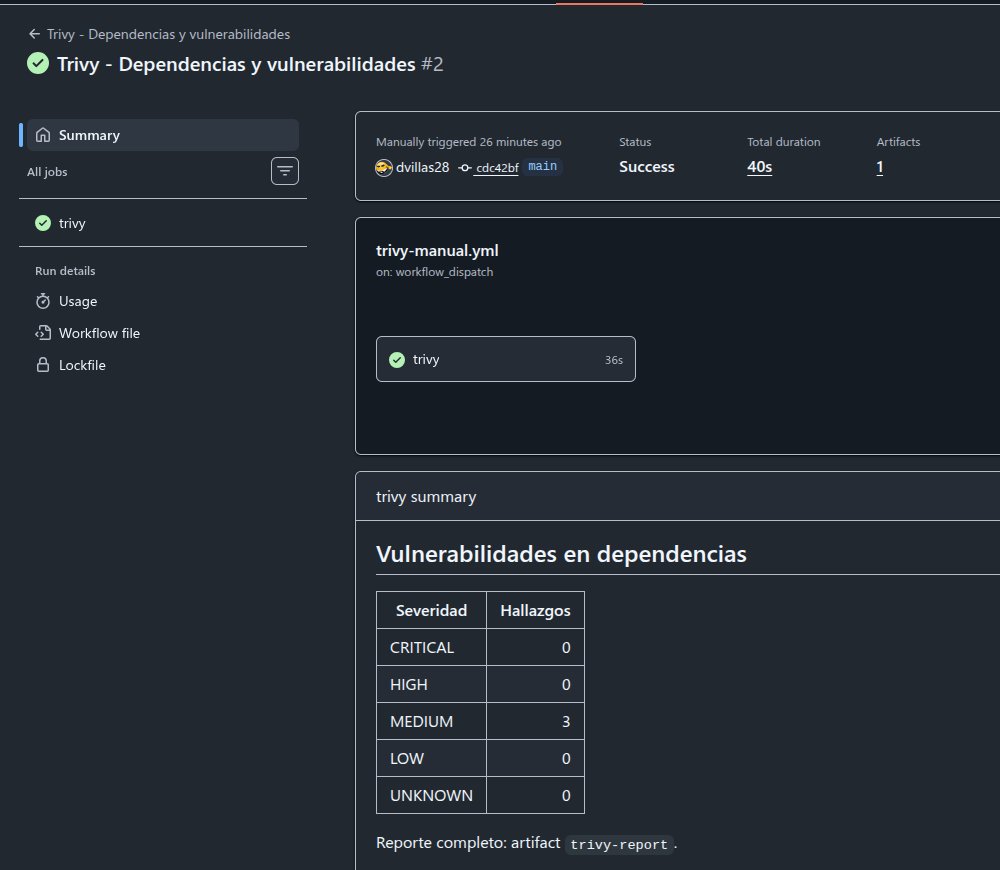
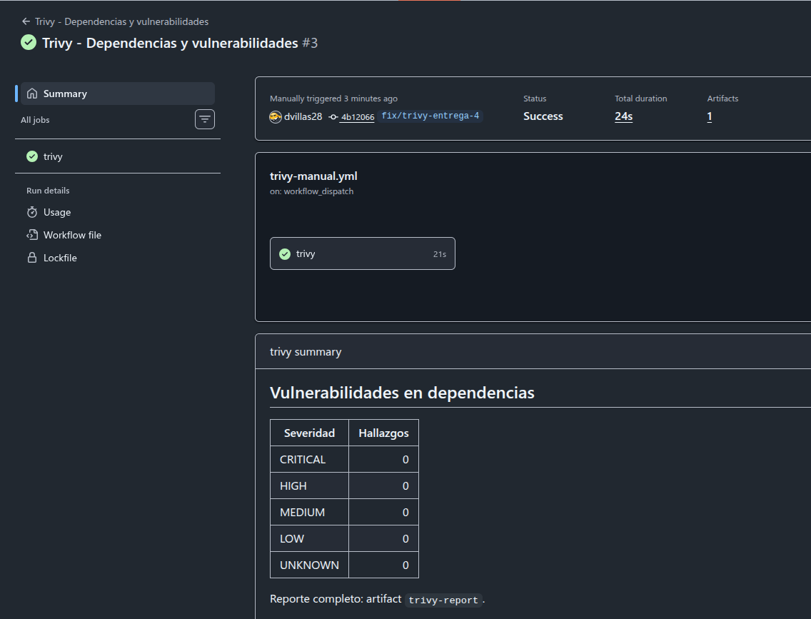

# Entrega 4 — Auditoría manual con Trivy

Ejecución manual de Trivy, corrección de todos los hallazgos y reporte posterior.
Fecha: **2026-11-13**. Trivy **0.75.0** (imagen oficial fijada por digest en
[`.github/scripts/trivy.sh`](../../../../.github/scripts/trivy.sh)), base de
vulnerabilidades del mismo día.

| Corte | Commit | Rama |
| --- | --- | --- |
| Antes | `fb8aa50` (tip de `dev`) | `dev` |
| Después | `63a1121` | `fix/trivy-entrega-4` |

## Alcance

1. **Repositorio** (`trivy fs .`): igual que el workflow manual
   [`trivy-manual.yml`](../../../guides/security-audit-workflows.md), con todas
   las severidades, y además los escáneres `secret` y `misconfig` que usa el CI.
2. **Imágenes Docker** (`trivy image`) de `backend` y `frontend`, construidas
   desde cada commit con sus `Dockerfile`. Es lo que se despliega en Render.

Ambos cortes se escanearon sobre un checkout limpio (`git worktree`) para que
archivos locales no versionados (`.env`, `node_modules`, `coverage/`) no
entraran al reporte.

## Resumen

| Objetivo | Antes | Después |
| --- | --- | --- |
| Repo: vulnerabilidades | 3 MEDIUM | 0 |
| Repo: misconfiguraciones | 2 LOW | 0 |
| Repo: secretos | 0 | 0 |
| Imagen backend | 4 MEDIUM | 0 |
| Imagen frontend | 1 MEDIUM | 0 |

No hubo hallazgos HIGH ni CRITICAL en ningún corte.

## Hallazgos y corrección

| Hallazgo | Dónde | Severidad | Corrección |
| --- | --- | --- | --- |
| `qs` 6.16.0, CVE-2026-110816 (DoS) | backend: `express` → `qs` | MEDIUM | Override `qs: ^6.16.1` (queda 6.16.1). |
| `glob` 13.0.6, CVE-2026-118773 (DoS) | backend: `node-pg-migrate` → `glob` | MEDIUM | Override acotado `node-pg-migrate>glob: ^14.0.2` (queda 14.0.6). |
| `minimatch` 10.2.6, CVE-2026-118764 (DoS) | backend: `glob` → `minimatch` | MEDIUM | Se corrige con `glob` 14, que trae `minimatch` 11.0.8. |
| `zlib` 1.3.2-r1, CVE-2026-4738 | imágenes: base `node:24-alpine` | MEDIUM | `apk upgrade --no-cache` en la etapa `runner` (queda 1.4-r0). |
| DS-0026: falta `HEALTHCHECK` | `backend/Dockerfile`, `frontend/Dockerfile` | LOW | `HEALTHCHECK` con `node -e fetch(...)`. |

Notas:

- `node-pg-migrate` 9.0.0 (última estable) fija `glob ~13.0.0`, por eso hace
  falta override. El override es solo para ese paquete: el resto del árbol no
  cambia. El proyecto no usa `useGlob`, así que `glob` solo se carga al importar.
- La imagen `node:24-alpine` más reciente aún trae `zlib` 1.3.2-r1; Alpine ya
  publicó 1.4-r0. `apk upgrade` cubre también futuros parches de la base.
- El `HEALTHCHECK` del backend usa `/health` (no toca la base); Compose y Render
  siguen probando `/ready` con su propia configuración. El del frontend pide `/`
  sin seguir redirecciones, porque `/` puede redirigir a un origen institucional
  inaccesible desde el contenedor.

## Verificación

| Prueba | Resultado |
| --- | --- |
| `pnpm lint` (backend) | OK |
| `pnpm test` (backend, unitarios) | 52/52 |
| `pnpm test:integration` (backend, PostgreSQL 17 efímero, corre migraciones) | 210/210 |
| `node backend/test/compose-smoke.mjs` (imagen + Compose aislado) | PASS |
| `HEALTHCHECK` backend (Compose sin override de healthcheck) | `healthy` |
| `HEALTHCHECK` frontend (contenedor aislado) | `healthy` |
| Trivy repo + imágenes sobre `63a1121` | 0 hallazgos |

## Ejecución en GitHub Actions

El mismo antes/después, con el workflow del curso
([`trivy-manual.yml`](../../../../.github/workflows/trivy-manual.yml): solo
vulnerabilidades, dependencias de producción) ejecutado a mano en GitHub.

| Run | Rama | Commit | Hallazgos | Evidencia |
| --- | --- | --- | --- | --- |
| [#2](https://github.com/dvillas28/lock-in-team-iic3143-202602/actions/runs/43425746281) | `main` | `cdc42bf` | 3 MEDIUM (`qs`, `glob`, `minimatch`) | [captura](actions/run-2-main/resumen.png) · [reporte](actions/run-2-main/trivy-report.json) |
| [#3](https://github.com/dvillas28/lock-in-team-iic3143-202602/actions/runs/43429080868) | `fix/trivy-entrega-4` | `4b12066` | 0 | [captura](actions/run-3-fix/resumen.png) · [reporte](actions/run-3-fix/trivy-report.json) |

Los commits difieren de los cortes locales, pero el código es el mismo:

- `cdc42bf` es el merge de `dev` a `main` (PR #311). Su árbol es idéntico al de
  `fb8aa50` (`git diff cdc42bf fb8aa50` vacío); el merge solo crea otro commit.
- `4b12066` es el tip de la rama: contiene `63a1121` y solo agrega este reporte.

Los reportes JSON se descargaron con `gh run download <id> -n trivy-report`,
porque el artifact de Actions expira a los 14 días.





## Archivos

| Archivo | Contenido |
| --- | --- |
| [`antes/repo.txt`](antes/repo.txt) · [`antes/repo.json`](antes/repo.json) | Repo en `fb8aa50`. |
| [`antes/imagen-backend.txt`](antes/imagen-backend.txt) · [`.json`](antes/imagen-backend.json) | Imagen backend en `fb8aa50`. |
| [`antes/imagen-frontend.txt`](antes/imagen-frontend.txt) · [`.json`](antes/imagen-frontend.json) | Imagen frontend en `fb8aa50`. |
| [`despues/repo.txt`](despues/repo.txt) · [`despues/repo.json`](despues/repo.json) | Repo en `63a1121`. |
| [`despues/imagen-backend.json`](despues/imagen-backend.json) | Imagen backend en `63a1121`. |
| [`despues/imagen-frontend.json`](despues/imagen-frontend.json) | Imagen frontend en `63a1121`. |
| [`actions/`](actions/) | Captura y artifact `trivy-report` de los runs #2 y #3. |

Los `.txt` son la salida en tabla de Trivy; los `.json`, el reporte completo.
Las imágenes del corte "después" no tienen `.txt`: sin hallazgos, la tabla
detallada sale vacía.

## Fuera de alcance

Trivy omite por defecto las dependencias de desarrollo de pnpm, igual que el
workflow del curso. Con `--include-dev-deps` aparecen 30 hallazgos más, solo en
herramientas que no llegan a las imágenes: `@redocly/cli` y `redoc` en la raíz
(incluye 3 CRITICAL y 6 HIGH, vía `handlebars`, `dompurify`,
`fast-xml-parser` y `undici`), `fast-uri` y `glob`/`minimatch` en tooling de
backend, frontend y e2e.

## Cómo reproducir

Desde un checkout limpio del commit a auditar:

```bash
.github/scripts/trivy.sh fs --scanners vuln,secret,misconfig --severity UNKNOWN,LOW,MEDIUM,HIGH,CRITICAL --format table .
```

```bash
docker build -t academix-backend:audit backend && .github/scripts/trivy.sh image --severity UNKNOWN,LOW,MEDIUM,HIGH,CRITICAL academix-backend:audit
```

Para el frontend, lo mismo con `frontend`. Agregar `--format json --output <archivo>`
para guardar el reporte.
