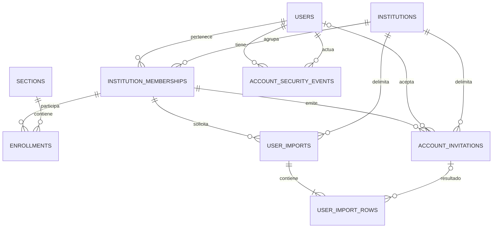

# Modelo propuesto de usuarios, perfiles y altas

Estado: lógico, pendiente de migraciones. [Requisitos](requisitos.md) · [CSV](importacion-csv.md).
User conserva identidad global; InstitutionMembership mantiene permisos por tenant.

## users completo, después de la ampliación

| Campo | Tipo propuesto | Nulo/default | Estado / propósito |
| --- | --- | --- | --- |
| id | uuid PK | No | Existente; identidad estable |
| email | varchar(254) | No | Existente; único por lower(btrim(email)) |
| password_hash | varchar(255) | No | Existente; PHC Argon2id, nunca contraseña legible |
| name | varchar(200) | No | Existente; nombre visible editable, trim no vacío |
| bio | varchar(500) | Sí | Nuevo; descripción en texto plano |
| avatar_key | varchar(512) | Sí | Nuevo; referencia interna al objeto de foto |
| credential_version | integer | No / 0 | Nuevo; CHECK ≥0, revoca JWT anteriores al incrementarse |
| active | boolean | No / true | Existente; estado global, no editable desde perfil |
| created_at | timestamptz(6) | No / now() | Existente |
| updated_at | timestamptz(6) | No / now() | Existente; concurrencia optimista de perfil |

No agregar institution_id ni role a users. Correo global permanece solo lectura
en perfil; los administradores no pueden editar la identidad global de otros.
La imagen vive fuera de PostgreSQL; DB guarda clave, no bytes/base64 ni URL arbitraria.
Producción: [S3 privado, provisionado por Daniel](../../adr/s3-for-profile-photos.md);
desarrollo: local. Matías integra el almacenamiento con el flujo de perfil.

## institution_memberships y enrollments, sin columnas nuevas

Membership: id PK, institution_id FK, user_id FK, active, is_admin DEFAULT false,
is_super_admin DEFAULT false, created_at, updated_at. UNIQUE(institution_id,user_id)
y UNIQUE(institution_id,id). La ampliación autoriza altas con is_admin OR is_super_admin.
Delegar is_admin sigue exigiendo is_super_admin; asignar este último sigue siendo operativo.
Enrollment: id, institution_id, section_id, user_id, role, active, created_at;
teacher/student/assistant por sección, múltiples roles distintos sin duplicar activo.
FK compuesta a memberships; el alta formulario/CSV no crea Enrollment.

## Nuevas tablas de soporte

| Tabla y frontera | Campos principales | Integridad / acceso |
| --- | --- | --- |
| account_invitations, institucional | id, institution_id, normalized_email, invited_name, created_by, token_hash, expires_at, accepted_at, revoked_at, accepted_user_id, operation_key, input_fingerprint, created_at, pii_purged_at | Token hash único, estados excluyentes; FK creador membership; RLS; UNIQUE(institution_id,id) |
| user_imports, institucional | id, institution_id, created_by, status, input_fingerprint, operation_key, total_rows, created_count, skipped_count, created_at, expires_at, confirmed_at, pii_purged_at | UNIQUE(institution_id,id); FK creador membership; RLS; clave idempotente por actor/tenant |
| user_import_rows, institucional | id, institution_id, import_id, row_number, name, normalized_email, validation_code, outcome, invitation_id | UNIQUE(institution_id,import_id,row_number); FK compuestas a lote/invitación; RLS |
| account_security_events, global propio | id, user_id, actor_user_id, action, occurred_at, metadata | FKs a users; inmutable; solo titular/operación autorizada, nunca secretos |

Invitación puede venir de formulario o de una fila CSV; una ya pendiente puede
ser referenciada como omitida sin emitir otra. accepted_user_id es FK global a users.
Resend agrega estado/versión/clave de entrega, ID proveedor, intentos y fechas/error
en account_invitations; [campos y recuperación](correo-resend.md). Hash/expiración
son null antes del primer despacho; emisión exige ambos, hash único y código de 24 h.
Aceptar exige hash vigente y guarda accepted_user_id; delivery accepted no activa la cuenta.
El estado del lote recorre previewed → confirmed o expired; preview con errores
no confirma. Las filas guardan errores/omitidas/creadas como invitación, no un rol.
Las CHECK y FK deben impedir accepted+revoked y relaciones lote/fila/invitación cruzadas.
El archivo CSV es efímero: solo parsing en memoria, sin almacenamiento binario o
codificado. Aplicar [limpieza aprobada](retencion.md): filas/lote a los 7 días, invitaciones a los 30.
Agregar pii_purged_at a lotes/invitaciones; name/email/fingerprint temporales admiten null
tras depurar, manteniendo IDs/FK/fechas/estados. Hash puede ser null en invitación cerrada
y depurada; nunca en una emitida vigente. Constraints deben distinguir esos estados.
Solicitudes sin primera emisión se revocan/depuran a los 30 días desde creación como default.
Unicidad de invitación pendiente excluye cerradas/depuradas; estas no admiten envío/renovación.
Índices por institution_id+estado/fecha para listados; token_hash único para aceptación.
No usar now() en predicados de índices parciales: expiración se valida al operar.

## Relaciones

El vínculo desde membership a Enrollment usa (institution_id,user_id);
las nuevas relaciones entre tablas institucionales incluyen institution_id en la FK.
Eventos institucionales de invitación/lote se guardan en audit_events existente;
ampliar su CHECK sin curso/resource_type, snapshots y políticas para estos recursos.
Eventos globales de perfil/contraseña/foto no fuerzan una institución ficticia.

## Cuándo se crea cada registro

| Acción | Efecto persistente previsto |
| --- | --- |
| Guardar perfil | UPDATE propio users + evento global |
| Cambiar contraseña | UPDATE hash/version + evento global; invalida JWT previos |
| Enviar formulario de alta | Invitación pendiente + evento institucional; sin User/membership aún |
| Validar CSV | Lote/filas de staging, con errores o válidas; sin altas |
| Confirmar CSV válido | Invitaciones nuevas + resultados/recibo + eventos, todo atómico |
| Enviar por Resend | Nueva versión/hash + resultado de envío; red posterior al commit, sin crear User |
| Titular nuevo activa | User + membership sin flags + consumo/evento, todo atómico |
| Titular existente acepta autenticado | Membership sin flags + consumo/evento; User conserva credenciales |
| Matricular en un curso | Enrollment por flujo existente y permiso académico correspondiente |

Ejemplo: Ana pertenece a UC y UTFSM con el mismo users.id. Cambiar bio/foto
afecta su perfil global. Un admin UC solo emite altas UC; no conoce ni cambia
su pertenencia UTFSM. Una fila CSV que ya pertenece a UC se omite sin duplicarla.

## Seguridad y evolución

Proponer operaciones SQL acotadas para escritura propia/aceptación, manteniendo
prohibido UPDATE/INSERT arbitrario a users desde academix_runtime; ver
[barrera runtime y sesiones](datos-seguridad.md). No usar el pool del operador en HTTP.
Cuatro tablas nuevas responden a requisitos concretos: activación segura,
recuperación de un lote tras timeout y auditoría global independiente del tenant.
Migraciones aditivas; no borrar ni reasignar users, memberships, enrollments,
notas o intentos. Mantener Argon2id y credenciales existentes durante backfill.
El catálogo histórico y su XLSX/PDF siguen representando el esquema implementado;
este anexo enlazado muestra la extensión pendiente y no certifica cambios en DB.
